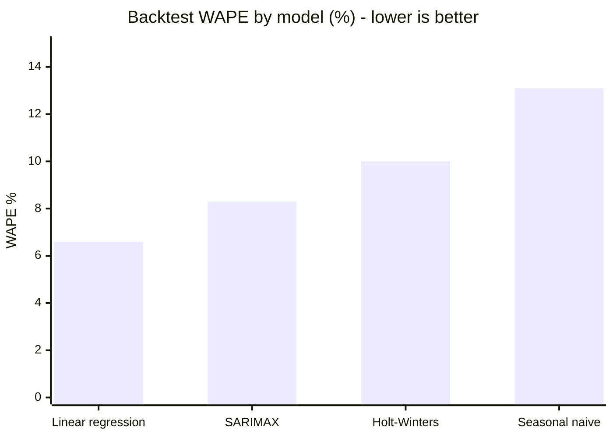
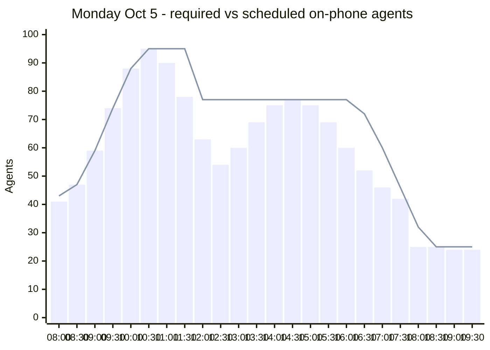
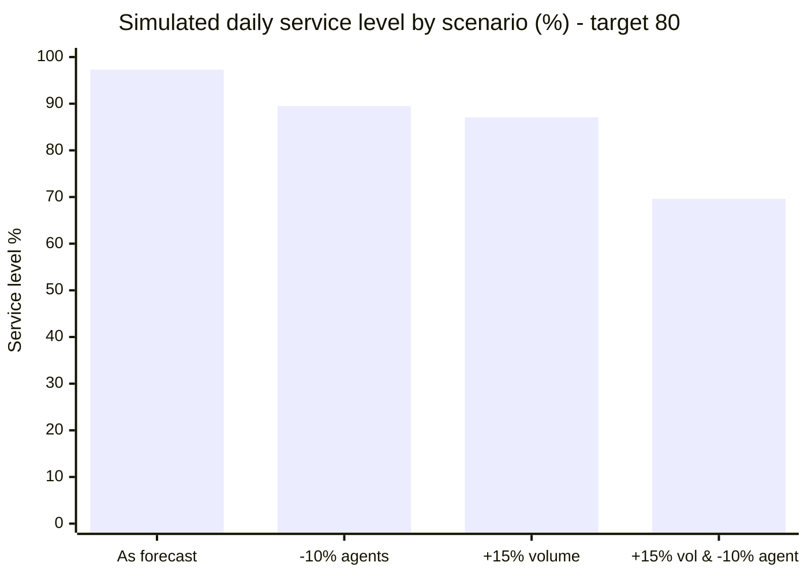

# Operations Capacity Planning: Forecast → Staffing → Shift Optimization → Simulation

An end-to-end capacity model for a contact-center operation. It forecasts daily volume, converts it to interval staffing with Erlang C, picks the lowest-cost full-time/part-time shift plan with a **Gurobi** mixed-integer program, and stress-tests the plan with a **SimPy discrete-event simulation**. It comes with model documentation written to Model Risk Management (MRM) standards: [MODEL_DOCUMENTATION.md](MODEL_DOCUMENTATION.md).

**Stack:** Python, pandas, statsmodels (linear regression, Holt-Winters, SARIMAX), SimPy, Gurobi, holidays

> **Data:** Real operations volumes are confidential, so `data.py` generates 3.75 years of daily volume (Jan 2023 – Sep 2026) with realistic structure: weekly cycle, annual seasonality, +4%/yr growth, federal-holiday dips with next-day catch-up, and over-dispersed noise. Because the true structure is known, I can check that the models recover it.

## 1. Volume forecast: 6-origin rolling backtest, 28-day horizon

| Model | MAPE | WAPE | Bias |
|---|---|---|---|
| **Linear regression** (log volume; day-of-week, month, trend, holiday flags) | **6.8%** | **6.6%** | -0.8% |
| SARIMAX (1,0,1)(1,1,1)₇ + holiday regressors | 8.4% | 8.3% | +1.2% |
| Holt-Winters (additive, weekly) | 9.7% | 10.0% | -1.7% |
| Seasonal naive (benchmark) | 13.6% | 13.1% | -1.3% |

The regression model **halves forecast error against the benchmark** and won 4 of 6 backtest windows, so it is the champion.



## 2. Staffing: Erlang C by 30-minute interval

- **Inputs:** daily forecast × intraday arrival profile, 6-minute average handle time.
- **Target:** service level of 80% of calls answered within 30 seconds.
- **Output:** for the week of Oct 5, 2026, Monday (6,311 forecast calls) needs **between 24 and 95 agents on the phones**, depending on the interval.

## 3. Shift optimization (Gurobi MIP)

The model chooses how many 8-hour full-time and 4-hour part-time agents start in each 30-minute slot on each day.

- **Constraints:**
  - After 30% shrinkage (breaks, training, absence), on-phone agents must cover the requirement in all 168 intervals.
  - Part-time work is capped at 30% of paid hours.
- **Objective:** minimize labor cost.
- **Solve:** optimal (0% gap) in seconds.

| Result (week of Oct 5, 2026) | Value |
|---|---|
| Paid hours / FTE | 5,732 h / **143.3 FTE** |
| Weekly labor cost | **$175.7K** |
| vs. best full-time-only schedule | $209.3K → **16% savings** from the FT/PT mix |
| Gap to theoretical minimum (perfectly flexible staff) | 12% (shift-length granularity) |

**Monday: agents required (bars) vs. scheduled on the phones (line)**



**What a stricter service level costs**

| Service-level target | Weekly cost | FTE |
|---|---|---|
| 70% in 30s | $171.1K | 139.6 |
| **80% in 30s (plan)** | **$175.7K** | **143.3** |
| 90% in 30s | $182.8K | 149.1 (+4% cost) |

## 4. Simulation check (SimPy, Monday, 20 replications each)

Erlang C assumes exponential handle times, callers who never hang up, and steady arrivals. The simulation relaxes all three: it uses lognormal handle times, callers who abandon after 3 minutes on average, and staffing that changes every 30 minutes.

| Scenario | Service level | Abandon rate | Worst interval |
|---|---|---|---|
| Plan as forecast | **97.3%** | 1.0% | 91.1% |
| Plan with 10% fewer agents on the phones | 89.5% | 3.5% | 78.5% |
| Volume 15% above forecast | 87.1% | 4.2% | 74.7% |
| Volume +15% **and** 10% of agents absent | **69.6%** | 9.2% | 46.2% |



**Findings**

1. **The plan has a cushion.** Erlang C ignores abandonment, and shift lengths add extra coverage. Together they deliver 97% service, not the 80% target, so the plan absorbs either a 15% volume miss or 10% absenteeism on its own.
2. **A combined shock breaks the plan.** With both shocks, service falls to 70% and drops below 50% at the morning peak. **Recommendation:** set a same-day trigger (forecast miss over 10% *and* absence over 8%) to call in part-time or overtime staff.
3. **The 80% vs. 90% target is a small cost question.** Moving to 90% adds about $7K a week (+4%), which gives leadership a clear trade-off to decide.

## Run it

```bash
pip install -r requirements.txt     # gurobipy installs with a free size-limited license, enough for this model
python run_all.py                   # writes all tables to results/ (about 1 minute)
```

| File | What it does |
|---|---|
| `data.py` | Synthetic daily volume and intraday arrival profile |
| `forecast.py` | Four forecasting models, rolling-origin backtest, champion forecast |
| `staffing.py` | Erlang C service level and interval staffing |
| `schedule.py` | Gurobi shift-scheduling MIP |
| `simulate.py` | SimPy discrete-event simulation with abandonment |
| `run_all.py` | Runs the full pipeline and writes `results/` |
| `MODEL_DOCUMENTATION.md` | MRM-style model documentation: purpose, assumptions, limitations, validation, monitoring |

*Author: [Taha Su](https://www.linkedin.com/in/tahasu)*
